# Ejecutando-y-gestionando-contenedores-en-docker
# Prácticas de Docker

---

## 2.2. Tarea. Descarga de imágenes (OBLIGATORIA)

Una vez tenemos instalada la aplicación vamos a descargar una serie de imágenes que son de uso común y sobre las cuales realizaremos varias de las prácticas del sistema[cite: 1].

1. En el siguiente apartado se detalla la hoja de ruta para resolver la actividad[cite: 1].
2. Al final de esta tarea se encuentran los recursos necesarios para su realización[cite: 1].

Por lo tanto, para poder superar esta actividad debes descargar las siguientes imágenes[cite: 1]:

1. `ubuntu:18.04`
2. `centos:8`
3. `debian:9`
4. `mariadb:latest`
5. `mysql:5.7`
6. `httpd`
7. `tomcat:9.0.39-jdk11`
8. `jenkins/jenkins:lts`
9. `php:7.3-apache`

> Una vez hayas descargado todas las imágenes, ejecuta la orden de **Docker CLI** correspondiente y realiza un pantallazo del resultado[cite: 1].
---
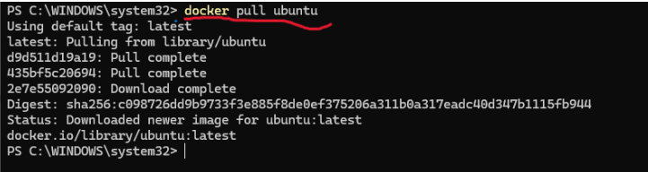


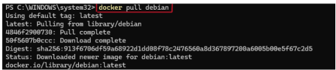


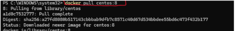


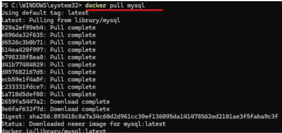


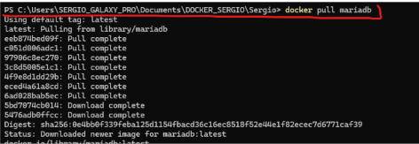


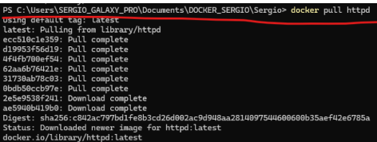


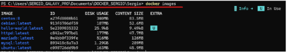


## 2.3. Tarea. Arranca un contenedor (OBLIGATORIA)

En esta tarea vas a arrancar un contenedor al que llamaremos `ubuntu`[cite: 2].


Arrancar un contenedor de la imagen **`ubuntu:18.04`** al que llamaremos `ubuntu`[cite: 2]. Una vez arrancado, realizar las siguientes operaciones[cite: 2]:

1. Salir del contenedor y capturar un pantallazo donde se pueda comprobar que ese contenedor se ha parado[cite: 2].


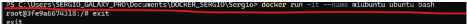
   
2. Rearrancar el contenedor desde tu equipo y capturar un pantallazo donde se pueda comprobar que está funcionando[cite: 2].
   

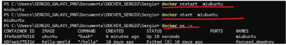

   
3. Sin entrar en el contenedor, mostrar por pantalla el fichero `/etc/os-release` y capturar un pantallazo del resultado[cite: 2].
   

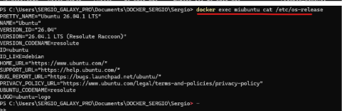
   

---

## 2.4. Tarea. Ejecutando servicios desde contenedores. Servidores web y de bases de datos (OBLIGATORIA)

En esta tarea vas a ejecutar varios servicios web y de bases de datos sobre contenedores.

Para poder superar esta actividad debes realizar las siguientes acciones:

1. Arranca un contenedor que ejecute una instancia de la imagen **`php:7.3-apache`**, que se llame `web` y que sea accesible desde tu equipo en el puerto `8181`.
2. Colocar en el directorio raíz del servicio web de dicho contenedor un fichero llamado `index.html` con el siguiente contenido:
   ```html
   <h1>HOLA SOY XXXXXXXXXXXXXXX</h1>

## 4. Arrancar un contenedor MariaDB

Arrancar un contenedor que se llame `bbdd` y que ejecute una instancia de la imagen `mariadb` para que sea accesible desde el puerto 3336.


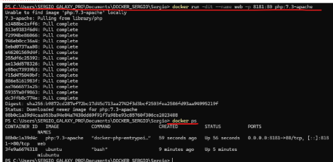


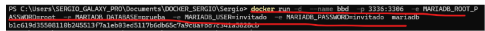


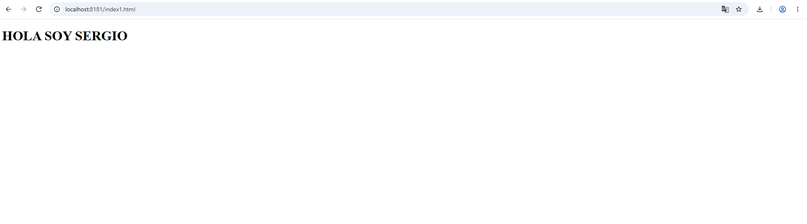

# Tarea 2.5. Obteniendo información de los contenedores (OBLIGATORIA)

En esta tarea vamos a obtener información de los contenedores creados previamente en la Tarea 2.4. *Ejecutando servicios desde contenedores. Servidores web y de bases de datos.*

Partiendo de los contenedores en ejecución de la tarea anterior y ejecutando la orden de Docker CLI adecuada, obtener la siguiente información realizando un pantallazo cada vez:

- Dirección IP del contenedor web.
- Redirección de puertos del contenedor web.
- Dirección IP del contenedor `bbdd`.
- Redirección de puertos del contenedor `bbdd`.

  
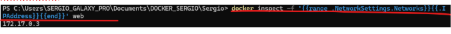


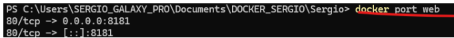


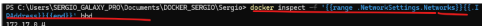


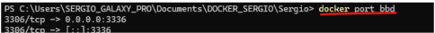


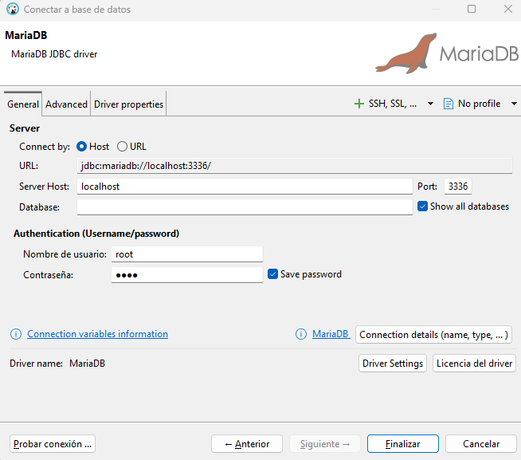


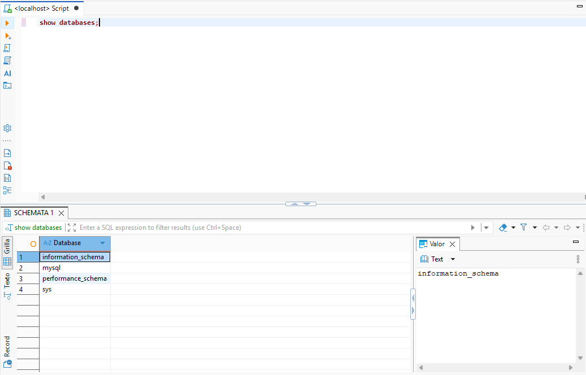

